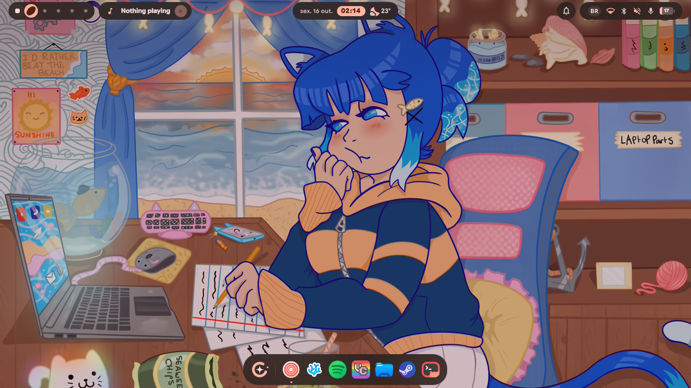
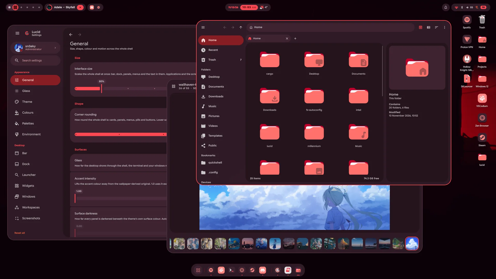
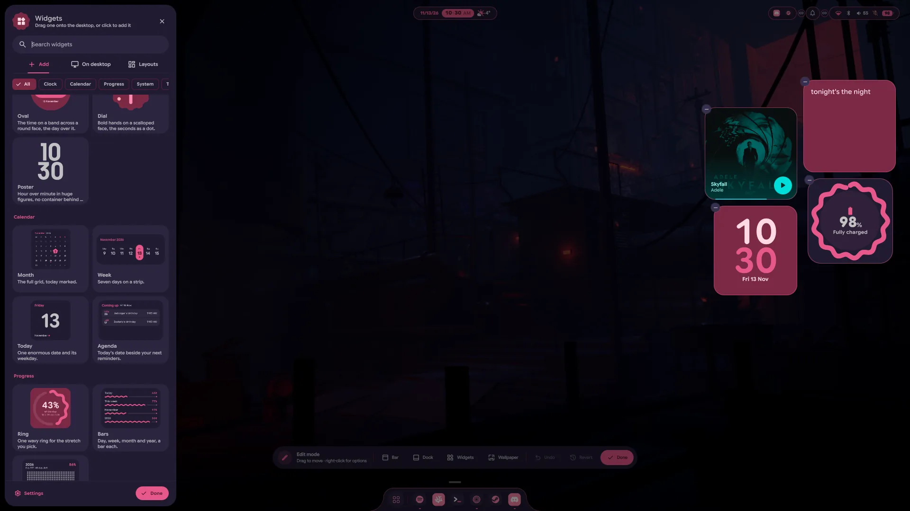
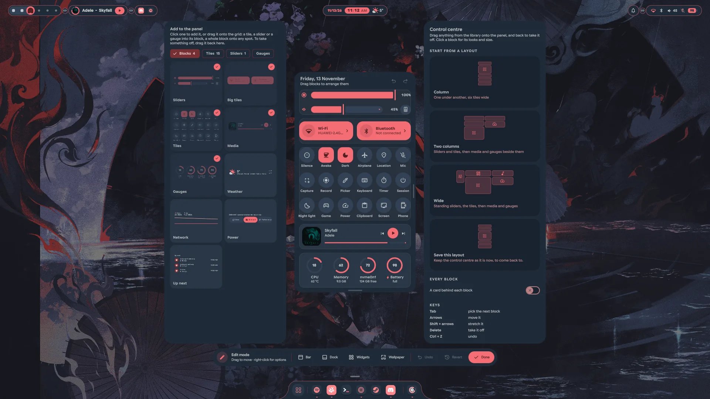
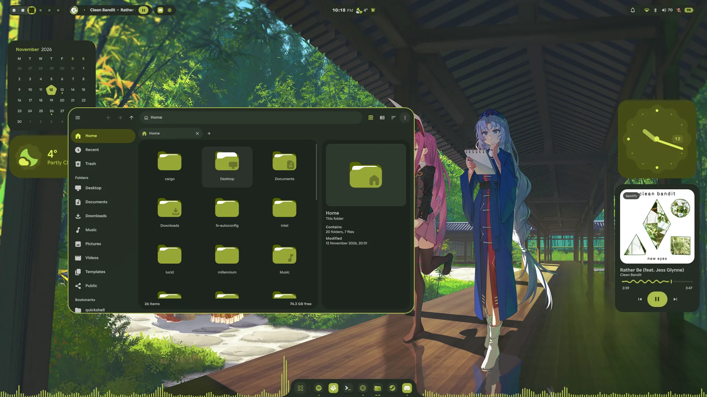
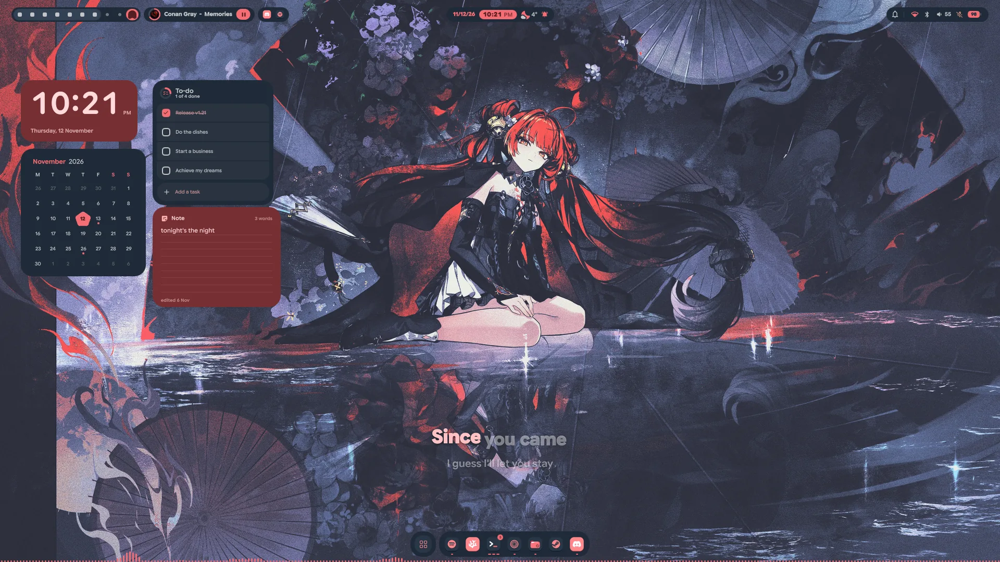
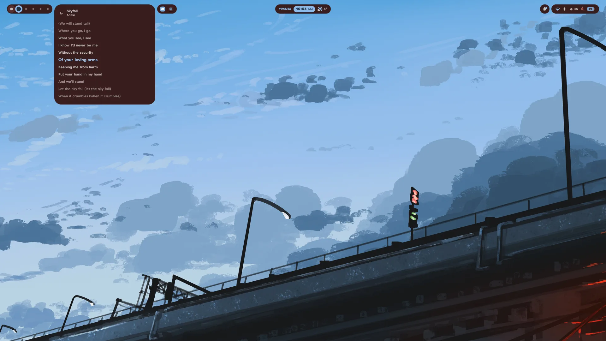
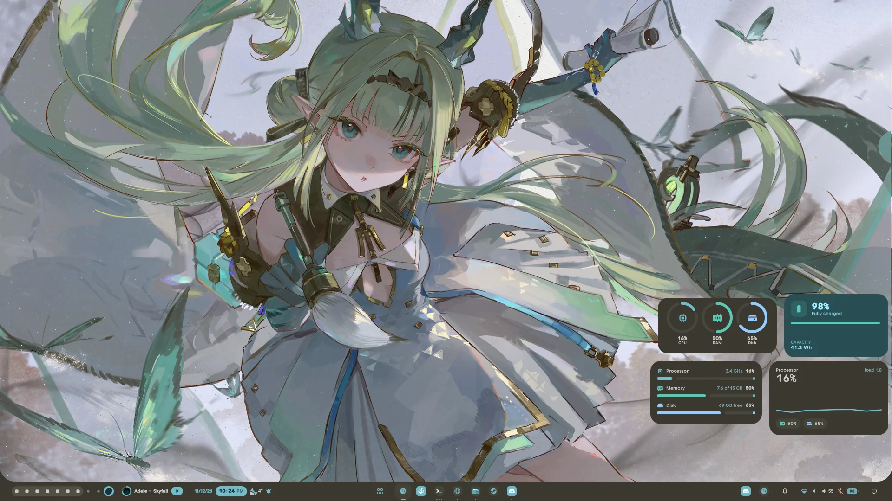
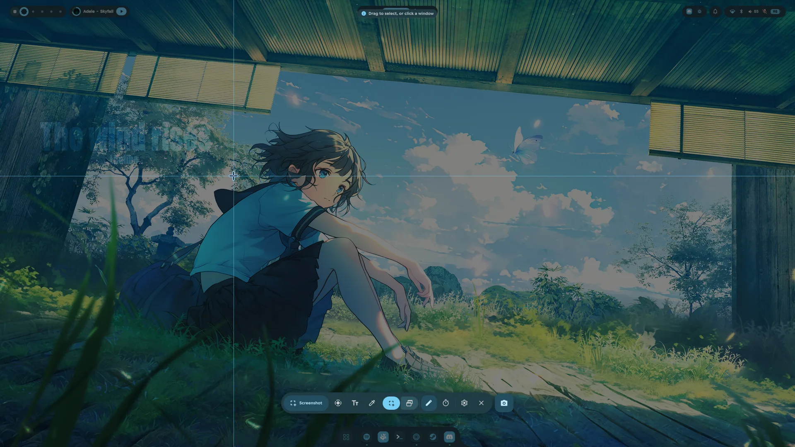
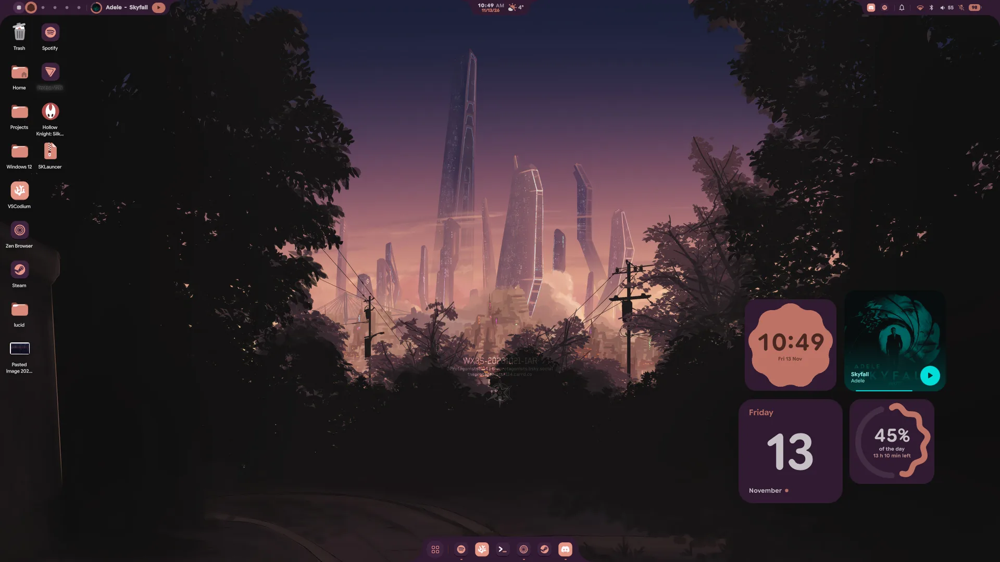

<div align="center">


# Lucid Marine

### Lucid, for Fedora and Ultramarine Linux.

A port of [Lucid](https://github.com/Sn3akyy1/lucid) to the Fedora ecosystem: a Material 3 Expressive desktop for Hyprland, built on [Quickshell](https://quickshell.org).<br>
The shell, its own apps, its own icons, pointer and login screen, all coloured by your wallpaper.

**[Install](#install)** &nbsp;·&nbsp;
**[Fedora port](#differences-from-upstream)** &nbsp;·&nbsp;
**[Tour](#a-tour)** &nbsp;·&nbsp;
**[What's in it](#whats-in-it)** &nbsp;·&nbsp;
**[Keybinds](#keybinds)** &nbsp;·&nbsp;
**[IPC](#ipc-reference)** &nbsp;·&nbsp;
**[Changelog](CHANGELOG.md)** &nbsp;·&nbsp;
**[Upstream website](https://sn3akyy1.github.io/lucid/)**

<p>
  <a href="https://github.com/Lily4U/lucid-marine/releases"></a>
  <a href="https://github.com/Lily4U/lucid-marine/stargazers"></a>
  <a href="https://github.com/Lily4U/lucid-marine/commits/main"></a>
  <a href="LICENSE"></a>
</p>
<p>
  
  
  
  <a href="https://quickshell.org"></a>
  <a href="https://github.com/Sn3akyy1/lucid"></a>
</p>



</div>

> [!TIP]
> **New in v1.21: Lucid is an ecosystem.** Lumen for your files and every app's
> file dialog, Lens for pictures and videos, LucidShot rebuilt, edit mode on the
> desktop, a bar that can take the bottom edge, a control centre you lay out
> yourself, lyrics for whatever plays, and icons and a pointer of Lucid's own.
> The shell shows the highlights once after you update; everything is in the
> [changelog](CHANGELOG.md#v121--2026-11-13).

> [!IMPORTANT]
> **This is a port.** Lucid is the work of Sn3akyy1 and its contributors, written
> for Arch Linux. Lucid Marine brings it to Fedora and Ultramarine Linux (the
> installer, the packages, the dock's apps) and merges upstream's changes as they
> land. [What differs](#differences-from-upstream) is in one place below.

> [!NOTE]
> **Hear about new versions** with **Watch → Custom → Releases** at the top of
> this page. See [Updating](#updating).

## The ecosystem

<table>
<tr>
<th width="33%">The shell</th>
<th width="33%">Its apps</th>
<th width="33%">Its look</th>
</tr>
<tr valign="top">
<td>

[The bar](#the-bar) in islands, notches or one full strip, top or bottom<br>
[A dock that grows into the launcher](#dock-and-launcher)<br>
[The control centre](#control-centre), laid out by you<br>
[Desktop widgets](#desktop-widgets) and [desktop icons](#desktop-icons)<br>
[Edit mode](#edit-mode) to arrange it all in place<br>
[Notifications, the OSD and toasts](#notifications-osd-and-sounds)<br>
[Lock and login screen](#lock-login-and-session)

</td>
<td>

[**Lumen**](#lumen), files and every file dialog<br>
[**Lens**](#lens), pictures and videos<br>
[**LucidShot**](#lucidshot), screenshots, text, colour and recording<br>
[**Settings**](#settings), the whole desktop without a config file<br>
[Lyrics, music and the visualiser](#music)<br>
[Emoji, GIFs and the clipboard](#dock-and-launcher)<br>
[A phone, over KDE Connect](#settings)

</td>
<td>

[One palette from your wallpaper](#theming), light or dark<br>
Every app themed along: GTK, Qt, KDE, kitty, Zen, VSCodium<br>
[Icons of Lucid's own](#look-and-motion)<br>
[A pointer of Lucid's own](#look-and-motion)<br>
[Sounds of its own](#notifications-osd-and-sounds)<br>
[Motion on springs](#look-and-motion)<br>
Google Sans Flex, built in

</td>
</tr>
</table>

## A tour

<table>
<tr>
<td width="50%"><br><sub><b>Its own apps.</b> Settings, Lumen and Lens, all in the colours of the wallpaper.</sub></td>
<td width="50%"><br><sub><b>Edit mode.</b> The widget panel beside the desktop it arranges.</sub></td>
</tr>
<tr>
<td><br><sub><b>The control centre's editor.</b> Blocks to add, the panel itself, and layouts to start from.</sub></td>
<td><br><sub><b>Lumen.</b> Places, folders and a preview pane, in a green palette.</sub></td>
</tr>
<tr>
<td><br><sub><b>Lyrics on the desktop.</b> The widget sings along, word by word.</sub></td>
<td><br><sub><b>Lyrics in the bar.</b> The media panel follows the song line by line.</sub></td>
</tr>
<tr>
<td><br><sub><b>The bottom edge.</b> One full bar, the dock's apps in the middle of it.</sub></td>
<td><br><sub><b>LucidShot.</b> Drag out a region or click a window on the frozen screen.</sub></td>
</tr>
<tr>
<td colspan="2"><br><sub><b>Desktop icons and widgets.</b> Your Desktop folder on the wallpaper, a shaped clock, what is playing, today and how much of the day has gone.</sub></td>
</tr>
</table>

## Install

Lucid Marine needs **Ultramarine Linux**, **Fedora** or a derivative of it (the
installer checks `ID` and `ID_LIKE`), with `dnf`, and **Hyprland 0.55 or newer**
(the installer brings Hyprland from a COPR if it is missing). It installs to
`~/.config/quickshell`:

```sh
git clone https://github.com/Lily4U/lucid-marine.git
cd lucid-marine
./install.sh
```

The installer runs in the terminal and asks before it installs anything: answer
`Y/n`, or pass `-y` to accept every prompt. Don't run it as root; it asks for
`sudo` when it needs it. At the end, `hyprctl reload` puts the new binds live
(log out and back in to pick up the autostart too), and `qs` starts the shell.
Set a wallpaper from **Settings → General** on first run; that is what your
colours come from.

<details>
<summary><b>What the installer does</b></summary>
<br>

1. **Checks your system** and refuses to start anything it cannot finish, rather
   than leaving you half-installed: Fedora or a derivative, `dnf`, not root, and
   run from inside the repo. A missing Hyprland is a warning at this point, not
   an error.
2. **Installs dependencies with `dnf`**, the official repos first (Fedora, RPM
   Fusion and Terra, which Ultramarine ships). It lists what is missing and asks;
   a name no repo knows is skipped, so one gap never sinks the batch, and if you
   say no it carries on, naming the features that won't work. What Fedora doesn't
   carry comes from COPRs, each one asked about separately and only when
   something is still missing. COPRs are unofficial and maintained by
   individuals:
   - `errornointernet/quickshell` for quickshell
   - `avengemedia/danklinux` for matugen, cliphist, hyprsunset, hypridle and cava
     (matugen is built with `cargo` if no repo has it)
   - `ashbuk/Hyprland-Fedora` for Hyprland itself
   - `aahsnr-work/base-pkgs` for `hyprland-guiutils`, if the other repos lack it
3. **Fetches what Fedora doesn't package:** the JetBrainsMono Nerd Font (once,
   into `~/.local/share/fonts`), and the dock's default apps as **Flatpaks** from
   Flathub (Zen, VSCodium, Vesktop, Spotify and Steam; several GB, `--no-apps`
   skips them, and an equivalent you already have counts).
4. **Copies the shell** to `~/.config/quickshell`, moving an existing one to
   `~/.config/quickshell.backup-<timestamp>` first, and carries your settings,
   pins, reminders and keys forward. Lumen and Lens come with it: Lumen opens
   folders, `SUPER`+`E` and every app's open and save dialog, and Lens opens
   pictures.
5. **Checks who serves notifications** and offers to stop another installed
   daemon from taking over (see [Troubleshooting](#troubleshooting)).
6. **Sets up Hyprland:** `hyprland.lua` and its modules, the keybinds, window
   and layer rules, blur, animations and an autostart. A config of your own is
   backed up and you are asked first (`--no-hypr` keeps it untouched, and it
   still gets the one module Lumen's dialogs need). On a re-run every module is
   checked against the one in place: new and updated ones are named, and so is
   one you edited, with your version in the backup.
7. **Sets up theming:** the palettes, the wallpaper hook and the matugen
   templates. An existing `matugen/config.toml` is appended to, never replaced.
8. **Applies the look:** kitty's colours, opacity and fish, the starship prompt,
   a fastfetch config (only where you have none), the VSCodium theme, and GTK as
   `adw-gtk3-dark` with the FairyWren icons, in `gsettings` and both
   `settings.ini`. `--no-look` skips it.
9. **Builds the tilting cursor**, a Hyprland plugin compiled against your own
   Hyprland (`hyprland-devel`) and rebuilt by itself after an update
   (`--no-plugins` skips it). A failed build only leaves a cursor that doesn't
   tilt. See [Known issues](#known-issues).
10. **Installs the login screen theme** when SDDM is there (it needs `sudo`),
    without switching to it, and offers fingerprint login if `pam_fprintd` is
    present. Then it **pins the dock** with the apps you actually have, and
    builds the colour picker when `colorpicker/` ships.

</details>

<details>
<summary><b>Installer options</b></summary>
<br>

| Flag | What it does |
| --- | --- |
| `--no-theming` | Skips the palette layer and leaves `~/.config/lucid` and `~/.config/matugen` alone |
| `--no-hypr` | Keeps your Hyprland config. Lucid's binds, rules, blur and autostart are not installed |
| `--with-hypr` | Reinstalls Lucid's Hyprland config even when one is in place |
| `--no-apps` | Doesn't install the dock's default apps (Zen, VSCodium, Vesktop, Spotify, Steam, as Flatpaks) |
| `--no-look` | Leaves kitty, starship, fastfetch and VSCode settings alone |
| `--no-wallpapers` | Doesn't copy the bundled wallpapers (about 1.3 GB, live ones included) |
| `--no-plugins` | Doesn't build the tilting-cursor plugin |
| `--skip-deps` | Never installs packages, only reports what is missing |
| `-y`, `--yes` | Accepts every prompt |
| `-h`, `--help` | Shows the list above |

</details>

<details>
<summary><b>The login screen</b></summary>
<br>

With SDDM installed, the installer puts Lucid's theme in
`/usr/share/sddm/themes/lucid` but never makes it the active one: that stays your
call. To switch to it, set this in `/etc/sddm.conf`:

```ini
[Theme]
Current=lucid
```

Fingerprint login, if you want it, adds two lines to `/etc/pam.d/sddm`, backed up
first. The installer asks before touching it.

</details>

### Updating

Update by hand, the same as installing:

```sh
cd lucid-marine
git pull
./install.sh
```

Your settings, pins, reminders and keys are carried forward, and whatever the
installer replaces is backed up beside it. Older versions stay on the
[releases page](https://github.com/Lily4U/lucid-marine/releases) and as tags:
`git clone --branch <tag> https://github.com/Lily4U/lucid-marine.git`.

<details>
<summary><b>Uninstall</b></summary>
<br>

```sh
./uninstall.sh
```

It moves `~/.config/quickshell` aside rather than deleting it, so your settings
survive, and leaves the packages alone. The installer notes how things stood
before it first changed them, and the uninstaller offers to put those back: the
login screen, the GTK theme, icons and dark mode, and your own Hyprland config
(or Hyprland's default). It ends by naming the desktop to log back into, and
lists what else it left in place, each with a timestamped backup beside it.

</details>

## Differences from upstream

<table>
<tr>
<th width="20%"></th>
<th width="40%">Upstream (Arch)</th>
<th width="40%">Lucid Marine (Fedora)</th>
</tr>
<tr valign="top"><td><b>Distro</b></td><td>Arch Linux</td><td>Ultramarine Linux, Fedora and its derivatives</td></tr>
<tr valign="top"><td><b>Packages</b></td><td><code>pacman</code>, and <code>paru</code> or <code>yay</code> for the AUR</td><td><code>dnf</code>, with COPRs for what Fedora doesn't carry, each asked about first</td></tr>
<tr valign="top"><td><b>Hyprland</b></td><td>Brought by the installer if missing</td><td>Brought from the <code>ashbuk/Hyprland-Fedora</code> COPR if missing</td></tr>
<tr valign="top"><td><b>Dock apps</b></td><td>Installed as packages, mostly from the AUR</td><td>Flatpaks from Flathub. Proton VPN is left out: it has no Flathub build</td></tr>
<tr valign="top"><td><b>Nerd Font</b></td><td>A package</td><td>Fetched once from the Nerd Fonts release</td></tr>
<tr valign="top"><td><b>Installer</b></td><td>A window in a Wayland session, or the terminal</td><td>The terminal</td></tr>
<tr valign="top"><td><b>Login screen</b></td><td><code>--login-screen</code> makes it the active theme</td><td>The theme is installed; you switch to it by hand</td></tr>
<tr valign="top"><td><b>No Fedora package</b></td><td></td><td><code>awww</code> (the wallpaper daemon: build it from source) and <code>songrec</code> (optional: <code>cargo install songrec</code>)</td></tr>
</table>

### Known issues

- **The pointer.** The tilting cursor is built by the installer, but the mouse
  pointer isn't fixed in this port yet. Pull requests are welcome. Nothing else
  depends on it.

## What's in it

Every surface is themed from the same palette and moves the same way. Click a
part to open it.

### The bar

<details>
<summary><b>Islands, notches or one full strip, along the top or the bottom</b></summary>
<br>

Eleven modules, each a pill that opens into a panel: **Workspaces**, **Media**,
**Tray**, **Clock**, **Notifications**, **System**, **Privacy**, **Power**, the
**window title**, **Start** and **Apps**. Three shapes: **islands** (floating
pills), **notches** (flush with the edge, blending into it) and the **full
bar** (one strip across the screen, hanging into its corners). *Position* puts
it on the top or the bottom edge, and it slides over to the new one.

- **Panels open as one shape with the bar.** On a full bar and with notches an
  open panel grows out of the bar with no seam, panels side by side merge, and a
  module at either end can meet the screen's side and curve into it.
- **Joins.** In edit mode the link between two neighbours joins them into one
  island or one notch, and a join holds across a module that has emptied out.
- **Workspaces** with live window previews, a run of dots per display, and the
  scratchpad's apps as glyphs while it is open.
- **Media** as a turning disc, a still cover, bars, a progress pill or with
  previous, play and next; its panel side by side, with a large cover, as a
  turning record, over the blurred cover, or mini. Lyrics are a click away.
- **Tray**, rebuilt: each app in a slot of its own, or three stacked with a
  count. A click opens the tray, where each app is a row with its real name and
  its menu opens right in the row.
- **Clock** with the date, the time on an accent chip, and behind it today, the
  month with reminders, timers and a pomodoro, a stopwatch and world clocks.
- **System**: whichever of Wi-Fi, Bluetooth, the volume and its level, the
  microphone and the battery you pick, opening onto the control centre.
- **Start** opens the launcher, drawn as the dock's launcher button, Lucid's
  mark, your distro's logo, your picture or the word Start. **Apps** puts the
  dock's apps on the bar, with dots, names, menus and drag to reorder.
- **On the bottom edge** the dock steps aside, and on a full bar the launcher
  rises out of the bar itself, one piece of glass with it.
- *Open on hover*, *Auto-hide*, a bar on every display, and **Content size**,
  which scales what is in the bar from 80 to 140% without changing its height.

</details>

### Control centre

<details>
<summary><b>Quick settings on a grid you lay out yourself</b></summary>
<br>


The System pill opens the control centre: brightness and volume with their
devices behind them, Wi-Fi and Bluetooth with full panels, tiles, what is
playing, and gauges for the CPU, memory, disk and battery. Untouched it is one
column; the pencil opens its editor, lifted off the bar to the middle of the
display. Drag blocks in from the library on the left (sliders lying or
standing, big tiles and small ones, media, gauges, the weather, the network,
power profiles and what is up next), stretch them by any edge, and pick each
one's look on the right, or start from a layout. Undo, a right-click menu, keys
for everything, and tiles of your own that run your commands.
`qs ipc call controlcentre toggle` opens it from a keybind.

</details>

### Dock and launcher

<details>
<summary><b>A dock that grows into the launcher, with eight modes in one field</b></summary>
<br>

A floating toolbar with your pinned apps and running windows, drag to reorder,
optional magnification, and auto-hide that can be *Dynamic*: tucked away only
while a window is in the way. Three styles: **island**, **notch** (with edge
blends) and **split**, the launcher, the pins and the running apps as three
islands that fuse when the launcher opens and spring apart again. Pull a pin up
onto the desktop for a shortcut there. With the dock hidden the launcher opens
as a notch from the bottom edge.

The launcher is one search field over eight modes, each reachable by a pill,
`Ctrl` and its number, `Tab`, or a prefix:

| Mode | Prefix | What it does |
| --- | --- | --- |
| Apps | | Fuzzy search over your apps, their own actions and open windows; `vsc` finds Visual Studio Code |
| Commands | `>` | The shell's commands, power actions included |
| Emoji | `:` | The emoji picker's list; Return copies one |
| Web | `?` | Searches your engine, or opens what you typed if it is an address |
| Run | `$` | Runs a command, in the background or in a terminal that stays open |
| Theme | `>theme` | Switches palettes |
| Wallpaper | `>wallpaper` | Your wallpapers as a strip, pills, tiles or a bento grid, live ones beside them |
| Clipboard | `>clip` | What you copied, images included |

Type a sum for a calculator. Wallpapers change with a transition you pick
(fade, wipe, wave, grow and the rest of what `awww` does), and **live
wallpapers** play videos behind the desktop, holding still under a fullscreen
window.

</details>

### Desktop widgets

<details>
<summary><b>Twenty-five kinds, close to ninety looks, placed on the wallpaper</b></summary>
<br>

Open the widget panel (edit mode, the desktop's right-click menu or the
launcher's Widgets pill) and drag a widget out, or click it to drop it in the
first free spot. Each one has a sheet with every look drawn live, its colour,
size and own options, and snaps to the edges, the centre lines and the others.

| Widget | Looks |
| --- | --- |
| Clock | Digital, stacked, analog, inside an expressive shape, minimal, world clocks, a band across a round face, a scalloped dial, or the hour over the minute as a poster on the bare wallpaper |
| Calendar | The month, this week, today, or your next reminders |
| Progress | How much of the day, week, month and year has gone, as a wavy ring, bars or dots |
| System | Rings, meters, a graph, tiles or network throughput |
| Quick toggles | Round switches that turn into shapes, a pill of buttons, or Quick Settings tiles |
| Battery | A ring, a cell, full detail, or every wireless device that reports a charge |
| Media | Eight looks, from an artwork card to a cover cut to a shape that morphs with every track |
| Lyrics | Word by word, karaoke, or the whole song scrolling by |
| Visualiser | Bars, mirrored bands or a wave, sized by dragging any edge |
| Weather and Sun | Now, a forecast, a curve of the next hours, sunrise and sunset |
| Notes and To-do | A sticky note, a ruled sheet, one line; a checklist or just the next thing |
| Timer | Countdown, pomodoro or stopwatch |
| At a Glance | The date, the weather and the one thing worth knowing now |
| And more | Photo, Fetch, Thermals, Network, Games, Shortcuts, Search, GitHub, Palette, Phone |

</details>

### Desktop icons

<details>
<summary><b>Your Desktop folder on the wallpaper, the way a real desktop has it</b></summary>
<br>

Turned on in **Settings → General → Desktop icons**. Icons from your icon theme
(or Lucid's own), thumbnails, the Trash and your drives; click, Ctrl- or
Shift-click or draw a box, drag into folders, the Trash, a drive or another app.
Right-click for Cut, Copy, Rename and Delete along the top, *Open With*, Quick
Look (Space), *Get Info*, Compress and Extract, *Send To* (folders and phones),
tags and more; right-click the desktop for *New Item*, *View* and *Arrange By*.
Everything can be undone, and every key can be changed on the Keybinds page.
Widgets keep their space: icons step aside together and come back after.

</details>

### Edit mode

<details>
<summary><b>Arrange the bar, the dock and the widgets where they stand</b></summary>
<br>


Pick **Edit Desktop** from the desktop's right-click menu, or right-click any
bar module, and the wallpaper shades over. Drag a bar module along the bar,
into another group, or down off it; join neighbours into one island; drag the
dock's handle up to float it or down into the edge to make it a notch.
Right-click a module or the dock for a sheet of its options beside it. The
toolbar opens the bar, dock, widgets and wallpaper; **Undo** (Ctrl+Z) and
**Revert** take changes back, and **Done** or Escape leaves.

</details>

### Lumen

<details>
<summary><b>A file manager of Lucid's own, and every app's file dialog</b></summary>
<br>


`SUPER`+`E`, the dock or any folder opens it, and every app's *Open* and *Save*
dialog is a Lumen window, with filters and an overwrite check. Tabs you can pin,
colour and drag out into a window of their own; bookmarks with names and
colours (Ctrl+D); Recent, Trash and your drives; a grid or a list from 24 to 256
pixels and a preview pane. **Network drives**: *Connect to server* (Ctrl+K)
opens `smb://`, `sftp://`, `ftp://` or a Windows `\\server\share`, signs in as a
user or a guest with the password in your keyring, and shows the computers
nearby. Copies and moves run in the background, and Lumen waits for them before
it quits.

</details>

### Lens

<details>
<summary><b>Pictures and videos, with an editor that never loses the original</b></summary>
<br>

Open a picture and its whole folder comes along: arrow keys, swipes and a
filmstrip, *All pictures* (G) to search the folder, zoom and pan with a map.
*Edit* (E) crops, turns, straightens, adjusts light and colour or applies one of
twelve looks; *Draw* (D) adds pens, arrows, shapes, words and pixelation. Saving
over a picture keeps its original for good, to bring back whenever you like.
Videos play in place with a waving time line, speed, frames to save and *Trim*.
Details, slideshow, full screen, and sending to your phone.

</details>

### LucidShot

<details>
<summary><b>Screenshots, recordings, text and colours from one toolbar</b></summary>
<br>


Print freezes the screen under a toolbar: **Screenshot**, **Record**, **Text** or
**Colour**, of a region, a window or the whole screen. A magnifier, edges that
snap to windows, Shift for a square, Space to move. The capture flies into a
card to open in Lens, mark up, pin over your windows, read the text off or drag
into an app. *Text* reads the words in any part of the screen (tesseract, emoji
and QR codes included) and pastes paragraphs as paragraphs; *Colour* copies HEX,
RGB or HSL and collects palettes; *Record* takes what is playing and the
microphone, with a countdown, a pill in the bar, and a GIF from the card.

</details>

### Music

<details>
<summary><b>Lyrics, covers, song identification and a visualiser</b></summary>
<br>


The media panel's **Lyrics** page scrolls with the song: the line being sung
springs up and fills with colour letter by letter, and a click on a line seeks
there. The **Lyrics widget** sings along on the desktop word by word, as
karaoke, or as the whole song scrolling by. Words come from lrclib.net, looked
up only while something shows them and kept on disk. **Identify** names the
song playing around you (`songrec`), and **cava** draws the visualiser, resting
while nothing plays.

</details>

### Lock, login and session

<details>
<summary><b>A lock screen, a matching login screen, and the session screen</b></summary>
<br>

- **Lock screen**: a real session lock checked through PAM, with an oversized
  clock in the wallpaper's colour, the weather, battery, network and Bluetooth
  at a glance, what is playing, notifications and a power bar. It counts your
  tries against faillock, warns about Caps Lock, plays a live wallpaper behind
  its blur, and takes a fingerprint (with `fprintd`) as well as the password.
- **Login screen**: the lock ported to SDDM, painted from the shell's own
  colours, each account with its own wallpaper and palette, live wallpapers
  included, and fingerprint login if you want it.
- **Session screen** (`SUPER`+`Esc`): lock, sleep, log out, restart and shut
  down on expressive shapes; the ones that cost you work ask twice.
- **Authentication**: Lucid is the session's polkit agent, so every
  administrator prompt comes up in its own dialog.

</details>

### Notifications, OSD and sounds

<details>
<summary><b>Grouped notifications, a notch OSD, toasts and Lucid's own sounds</b></summary>
<br>

Notifications are grouped by app with inline reply and progress bars, the
newest growing out of the bell; do-not-disturb has quiet hours and a rule for
fullscreen windows. The **OSD** shows volume, brightness, the microphone, Caps
Lock and Num Lock as a card or as a notch rising out of the bottom edge, and
with the dock a notch too, the dock itself turns into it. **Toasts** say small
things under the bar, and any script can raise one
(`qs ipc call -- toast show game "Game Mode On"`). **Sounds**: eight
notification sounds and the system's own, synthesised for Lucid, each with a
switch.

</details>

### Settings

<details>
<summary><b>The whole desktop, without a config file</b></summary>
<br>

A searchable app (`Ctrl+F`, or just type) with a page for every part of the
system, a reset arrow on anything you changed, and a What's new sheet after
each update. Among the pages:

- **General** with *Interface size* (75 to 125%), *Corner rounding* and *Motion*
- **Bar**, **Dock**, **Launcher**, **Widgets** and **Workspaces**
- **Theme**, **Colours**, **Palettes** and **Glass**
- **Windows** (gaps, borders, corners, shadows, tiling, focus) and **Input**
  (layouts, repeat, mouse, touchpad, swipes), live through Hyprland
- **Displays**: resolution, refresh, scale, rotation, arrangement and mirroring
- **Network**, **Bluetooth** (files both ways) and **Phone**, a full KDE Connect
  client with files, notifications, a media remote and a touchpad
- **Sound**, every device, socket and profile, a slider per app, and outputs
  played together
- **Notifications**, **Idle** (hypridle with sliders), **Storage** (what fills
  the disk, as a map), **Date & Time** (location, weather, units, time zone)
- **Environment**: cursor, icons, GTK and Qt themes and fonts, set everywhere at
  once, Lucid's own pointer included
- **Startup**: apps at login, system autostart and environment variables
- **Keybinds**, **Users and Accounts**, **Screenshots** and **About**

</details>

### Special workspaces

<details>
<summary><b>Scratchpads for music, chats, to-dos and the system monitor</b></summary>
<br>

| Keys | Workspace | Opens |
| --- | --- | --- |
| `SUPER` + `SHIFT` + `S` | Scratchpad | Somewhere to park windows |
| `SUPER` + `SHIFT` + `M` | Music | Spotify, Feishin, Cider, YouTube Music, TIDAL… |
| `SUPER` + `SHIFT` + `D` | Comms | Discord, Vesktop, Telegram, Signal, Element, Slack… |
| `SUPER` + `SHIFT` + `R` | To-do | Todoist, Planify, Errands, Obsidian… |
| `CTRL` + `SHIFT` + `Esc` | System | btop, Mission Center, Resources… |

A key starts its app if needed and slides the workspace over the one you are
on; the same key hides it. `SUPER`+`ALT`+`S` stashes a window in the
scratchpad. *Settings → Workspaces* picks the apps, the dimming and blur, and
makes workspaces of your own.

</details>

### Look and motion

<details>
<summary><b>Springs, Lucid's own icons and Lucid's own pointer</b></summary>
<br>

- **Jelly motion.** Panels, pills, menus, the dock, the OSD and widgets settle
  on a spring with a little wobble. *Settings → General → Motion* sets how much,
  or turns it off.
- **Icons.** Folders, files, places, drives and many apps share one tonal set
  drawn from your palette, in Lumen, on the desktop, in the dock and the
  launcher. An app the set doesn't know keeps its own icon.
- **Pointer.** Bibata Modern's shapes in your palette's colours (Dark, Light or
  Accent), fading along when the palette changes, drawn on your machine from
  Bibata's source. A tilting cursor leans the arrows and hands as they move,
  and in a drag the shell draws the pointer itself so it stays on what it holds.
  Any other cursor theme is a switch away.
- **Glass.** One slider for how far the desktop shows through the shell, kitty
  and your windows.

</details>

## Theming

<details>
<summary><b>One palette from your wallpaper, everywhere</b></summary>
<br>

**Matugen** and **Pywal** build a palette from your wallpaper, **Your colour**
from one colour you pick, and **Catppuccin Mocha**, **Gruvbox**, **Nightfox**,
**Nord** and **Tokyo Night** are fixed palettes. Every one has a light mode, and
the theme can follow each new wallpaper into light or dark. *Settings → Colours*
sets Matugen's style, its contrast and which of the wallpaper's colours to start
from.

The palette reaches beyond the shell: Hyprland's borders, kitty, starship, GTK,
Qt and KDE apps (through qt6ct and a colour scheme), Zen, VSCodium and the login
screen follow it, and any app can through a matugen template:

```toml
[templates.myapp]
input_path = '~/.config/matugen/templates/myapp.css'
output_path = '~/.config/myapp/colors.css'
post_hook = 'pkill -USR1 myapp'   # optional: tell the app to reload
```

*Settings → Colours* lists every template with how its last render went, adds
the ones Lucid ships for apps you have, and takes your own from a file or a
link. *Settings → Palettes* adds themes from a gallery of a few hundred base16
and base24 schemes, from any scheme repo or file, or from its editor, and
exports the palette on screen as a Lucid palette or base16 YAML.

```sh
python3 ~/.config/lucid/add-theme.py <repo-url|file|folder> [--list] [--variant <name>] [--name <label>]
```

</details>

## Keybinds

<details>
<summary><b>The binds Lucid ships</b> &nbsp;(<code>SUPER</code> + <code>/</code> shows them all, and Settings → Keybinds changes any of them)</summary>
<br>

| Key | Does |
| --- | --- |
| `SUPER` (tap) | Launcher |
| `SUPER` + `P` | Commands |
| `SUPER` + `T` / `B` | Theme / wallpaper picker |
| `SUPER` + `SHIFT` + `V` | Clipboard history |
| `SUPER` + `S` | Settings |
| `SUPER` + `.` | Emoji picker |
| `SUPER` + `K` | On-screen keyboard |
| `SUPER` + `/` | Every keybind |
| `SUPER` + `W` | Workspace overview (or a three-finger swipe) |
| `SUPER` + `Esc` | Session screen |
| `CTRL` + `ALT` + `TAB` | Window switcher, newest first (`+SHIFT` steps back) |
| `Print` / `SUPER` + `D` | LucidShot |
| `SUPER` + `Print` | Whole screen |
| `SUPER` + `SHIFT` + `T` / `C` | Copy text / pick a colour |
| `SUPER` + `E` | Lumen |
| `SUPER` + `C` | Close the window |
| `SUPER` + `V` | Float it at 1366×768, centred, or tile it again |
| `SUPER` + `J` | Toggle the split |
| `SUPER` + `1`–`0` | Workspace (`+SHIFT` moves the window there) |
| `SUPER` + arrows | Move focus |
| `SUPER` + `R` | Reload Hyprland |
| `SUPER` + `M` | Exit Hyprland |
| `F1`–`F6` | Mute, volume, microphone, brightness |
| `F8` / `F9` / `F10` / `F12` | Radios / terminal / lock / calculator |

Everything is also reachable over IPC, so a config of your own can bind it:

```lua
hl.bind("SUPER + SPACE", hl.dsp.exec_cmd("qs ipc call -- launcher toggle"))
hl.bind("SUPER + L",     hl.dsp.exec_cmd("qs ipc call -- lock lock"))
hl.bind("SUPER + A",     hl.dsp.exec_cmd("qs ipc call -- controlcentre toggle"))
```

Keep the `--`: a call that takes an argument fails without it
(`qs ipc call -- settings show bar`), and it does no harm elsewhere.

</details>

## IPC reference

<details>
<summary><b>Every surface is scriptable:</b> <code>qs ipc call -- &lt;target&gt; &lt;function&gt; [arg]</code></summary>
<br>

| Target | Functions |
| --- | --- |
| `launcher` | `toggle` `open` `close` `wallpaper` `live` `theme` `power` `emoji` `clipboard` `blur` `command` `shuffle` `search <query>` `hide <id>` `unhide <id>` `hidden` |
| `controlcentre` | `toggle` `open` `close` |
| `media` | `toggle` `open` `close` `identify` `lyrics` `playPause` `next` `previous` |
| `clock` | `open <tab>` `toggle` `close`, *tab* being `today`, `calendar`, `timer`, `stopwatch` or `world` |
| `timer` | `start <seconds>` `stopwatch` `pomodoro` `pomodoroSkip` `pomodoroStop` `pomodoroAdd <minutes>` `status` |
| `alarm` | `add <hour> <minute> <label>` `remove <id>` `list` `stop` `snooze` `status` |
| `workspaces` | `toggle` `open` `close` |
| `settings` | `toggle` `open` `close` `show <page>` `search <words>` `reset`, and a function per page (`bar`, `sound`, `displays`…) |
| `edit` | `toggle` `on` `off` `bar` `dock` `open <module>` `close` `undo` `revert` `status` |
| `widgets` | `panel` `openPanel <screen>` `closePanel` `add <type> <variant>` `remove <uid>` `preset <name>` `save <name>` `list` `catalogue` `toggle` `lock` `unlock`… |
| `desktop` | `icons` `arrange` `selectAll` `undo` `refresh` |
| `snap` | `toggle` `open` `close` `text` `color` `video` |
| `recorder` | `toggle` `start` `stop` `pause` `status` |
| `screenshot` | `full` `text` |
| `notifs` | `toggle` `open` `close` `clear` `toggleDnd` `expandAll` `settings` `count` |
| `toast` | `show <icon> <label>` `warn <icon> <label>` |
| `sounds` | `play <name>` `list` |
| `lock` | `lock` `unlock` `isLocked` `status` (nothing here gets past the password) |
| `session` | `toggle` `open` `close` |
| `switcher` | `next` `prev` `toggle` `open` `close` `status` |
| `keybinds` | `toggle` `open` `close` `edit` `editBind <id>` |
| `moji` | `toggle` `open` `close` `emoji` `kaomoji` `gif` `center` |
| `keyboard` | `toggle` `open` `close` `letters` `fnkeys` `center` `bigger` `smaller` |
| `idle` | `status` `keepawake` `awake` `normal` `on` `off` `restart` |
| `network` | `status` `list` `rescan` |
| `bluetooth` | `send <address> <path>` |
| `kdeconnect` | `status` `list` `rescan` `ring <id>` `ping <id>` `clipboard <id>` `files <id>` `send <id> <path>` |
| `nightlight` | `toggle` `on` `off` `status` |
| `displays` | `list` `settings` `shell <where>` `bar <where>` `dock <where>` |
| `updates` | `status` `check` `whatsnew` `update` `beta` `show` |
| `whatsnew` | `open` `close` `status` |
| `polkit` | `status` `demo <action-id>` `fail` `grant` `close` |
| `debug` | `toggle` `on` `off` (draws input and blur regions) |

Lumen and Lens run as their own processes with launchers of their own:
`~/.config/quickshell/lucidlumen/lumen [folder]` and
`~/.config/quickshell/lucidlens/lens <file>`.

</details>

## Requirements

<details>
<summary><b>What the installer pulls in</b></summary>
<br>

**Required:** `hyprland` · `quickshell` · `qt6-qt5compat` · `qt6-qtdeclarative` ·
`qt6-qtmultimedia` · `qt6-qtpdf` (Qt's PDF module, which Lumen's window needs)

**Per feature**, where a missing one breaks only its own feature:

| Packages | Back |
| --- | --- |
| `matugen` `jq` `python3-pywal` `awww` | Colours, themes and wallpapers |
| `NetworkManager` `qrencode` | Wi-Fi and sharing a network as a QR code |
| `bluez` `bluez-obexd` `python3-gobject` | Bluetooth, and files both ways |
| `kde-connect` `fuse-sshfs` | The Phone page and browsing a phone's files |
| `pulseaudio-utils` `wireplumber` `pipewire-utils` `sound-theme-freedesktop` | Sound, its devices and its tests |
| `gvfs` `gvfs-smb` `gvfs-nfs` `ffmpegthumbnailer` | Drives, network shares and thumbnails |
| `qt6-qtimageformats` `kf6-kimageformats` `libjpeg-turbo-utils` `exiv2` | Lens and pictures in every format |
| `grim` `wf-recorder` `ffmpeg-free` `ImageMagick` | Screenshots and recording |
| `tesseract` `tesseract-langpack-eng` `python3-pillow` `python3-numpy` `python3-fonttools` | Reading text off the screen, emoji included |
| `wl-clipboard` `wtype` `cliphist` | Pasting and clipboard history |
| `cava` `songrec` | The visualiser and song identification |
| `brightnessctl` `upower` `hypridle` `hyprsunset` | Brightness, battery, idle and night light |
| `polkit` `accountsservice` | Administrator prompts and the Users page |
| `qt6ct` `gsettings-desktop-schemas` `xdg-desktop-portal-gtk` `gtk-update-icon-cache` | The Environment page, and the file chooser KDE Connect sends files with |
| `librsvg2` | Lucid's pointer and the cursor shadow switch |
| `xdg-desktop-portal-hyprland` | Screen sharing and portals (installed with Hyprland) |
| `smartmontools` `udisks2` `inotify-tools` | Drive health, mounting, the camera toast |
| `curl` `libnotify` `xdg-utils` `zenity` `google-noto-color-emoji-fonts` | Weather, lyrics, notifications, links, dialogs, emoji |
| `xdg-terminal-exec` | The launcher's `$` mode, which falls back to your terminal without it |

A package already covered by an equivalent you chose yourself counts as
installed (`ffmpeg` for `ffmpeg-free`, say). `awww` and `songrec` have no Fedora
package and stay off until you build them.

**The Hyprland config and the look** (unless `--no-hypr` / `--no-look`): `kitty`
· `fish` · `playerctl` · `gnome-calculator` · `starship` · `fastfetch` ·
`adw-gtk3-theme` · `papirus-icon-theme`. The JetBrainsMono Nerd Font and the
FairyWren icons are downloaded rather than installed.

**Built on your machine when needed:** the colour picker (`clang` `make`
`wayland-devel` `wayland-protocols-devel`), the tilting-cursor plugin
(`hyprland-devel` `gcc-c++` `make` `pkgconf-pkg-config` `git`), and matugen
through `cargo` when no repo has it.

**The dock's default pins** (unless `--no-apps`), as Flatpaks:
`app.zen_browser.zen` · `com.vscodium.codium` · `dev.vencord.Vesktop` ·
`com.spotify.Client` · `com.valvesoftware.Steam`. An RPM or binary you already
have counts as an equivalent.

**Fonts:** Google Sans Flex ships with Lucid under the Open Font License, so
nothing needs installing; any installed font can be picked in Settings.

</details>

<details>
<summary><b>Optional setup</b></summary>
<br>

**GIF search** needs a free Giphy key from
[developers.giphy.com](https://developers.giphy.com/dashboard/) (Tenor works
too), in `~/.config/quickshell/lucidmoji/config.json`:

```json
{ "giphyKey": "your-key-here", "tenorKey": "", "gifDir": "" }
```

**Wallpapers** live in `~/Pictures/wallpapers`, a folder per theme; the folder
can be changed in Settings → General.

</details>

## Troubleshooting

<details>
<summary><b>Nothing appears when I run <code>qs</code></b></summary>
<br>

Check `qs log` for QML errors, and make sure you are on Hyprland: Lucid needs
its Wayland protocols and will not run on other compositors.

</details>

<details>
<summary><b>Another app's notifications show instead of Lucid's</b></summary>
<br>

`org.freedesktop.Notifications` belongs to whoever takes it first, and an
installed daemon (swaync, dunst, mako) is started by the first notification.
Check who holds it, mask the other one and log back in (the installer offers to):

```sh
busctl --user status org.freedesktop.Notifications | grep PID
systemctl --user mask swaync.service   # or dunst.service, mako.service
```

</details>

<details>
<summary><b>Everything is grey, or the colours look wrong</b></summary>
<br>

The palette cache is missing. Set a wallpaper through Settings → General, or
copy a bundled palette:
`cp ~/.config/lucid/themes/nord/quickshell.json ~/.cache/quickshell/matugen.json`

</details>

<details>
<summary><b>GTK apps are light, or their icons are wrong</b></summary>
<br>

GTK reads `~/.config/gtk-{3,4}.0/settings.ini` while GNOME apps and portals read
`gsettings`; the installer writes both. Check they agree:

```sh
gsettings get org.gnome.desktop.interface gtk-theme    # adw-gtk3-dark
gsettings get org.gnome.desktop.interface icon-theme   # FairyWren_Dark
```

</details>

<details>
<summary><b>The media panel's visualiser never moves</b></summary>
<br>

cava is running without `~/.config/cava/quickshell.conf`. Re-run the installer,
or copy `support/cava/quickshell.conf` there.

</details>

<details>
<summary><b>Animations feel choppy on an NVIDIA card</b></summary>
<br>

Qt refuses threaded OpenGL on the NVIDIA driver, which pins animations to about
60 fps. Lucid starts through `~/.config/lucid/launch-shell.sh`, which moves such
machines to Qt's Vulkan backend; `launch-shell.sh --explain` says what it
decided, and `LUCID_RHI_BACKEND=vulkan` or `opengl` overrides it.

</details>

<details>
<summary><b>A keybind with an argument does nothing</b></summary>
<br>

Put `--` before the target: `qs ipc call -- settings show bar`.

</details>

<details>
<summary><b>Icons look blurry</b></summary>
<br>

A fractional monitor scale puts icons on fractional pixels. Use a whole-number
scale, and size the shell with *Interface size* in Settings → General instead.

</details>

<details>
<summary><b>The installer says Hyprland is missing, or too old</b></summary>
<br>

Fedora has no official Hyprland package. The installer offers the
`ashbuk/Hyprland-Fedora` COPR, which builds the stable releases. Lucid's Lua
config needs 0.55 or newer; `hyprctl version` says which you have.

</details>

<details>
<summary><b>The wallpaper never changes</b></summary>
<br>

`awww`, the wallpaper daemon, has no Fedora package. Build it from source, put it
on your `PATH`, then pick a wallpaper in Settings → General.

</details>

<details>
<summary><b>The pointer doesn't tilt, or looks wrong</b></summary>
<br>

This is a [known issue](#known-issues). The plugin has its own script, which can
say what happened and try again, and nothing else in the shell depends on it:

```sh
~/.config/hypr/scripts/cursor-plugin.sh status
~/.config/hypr/scripts/cursor-plugin.sh build && ~/.config/hypr/scripts/cursor-plugin.sh load
```

</details>

## Contributing

Issues and pull requests are welcome. For a bug, `qs log`, your Hyprland version
and your Fedora or Ultramarine release help a lot. Something that isn't about
Fedora may belong [upstream](https://github.com/Sn3akyy1/lucid/issues) instead.

Lucid itself is the work of **Sn3akyy1** and its contributors, above all **Ciro
Rivera**, Lucid's co-developer. Lucid Marine is the Fedora port, by
[**Lily4U**](https://github.com/Lily4U).

<a href="https://github.com/Sn3akyy1/lucid/graphs/contributors"></a>

## The mark

<picture>
  <source media="(prefers-color-scheme: light)" srcset="assets/logo-mark-light.svg">
  
</picture>

The logo is **Lucida**, the astronomical name for the brightest star in a
constellation, from the same Latin root (*lux*) as Lucid: a broken orbit ring, a
four-point star at the centre and one companion outside the gap. Its colour is
**cyan `#00F0FF`**; in the shell the ring and the companion follow your accent.

<br clear="left">

## License

MIT, see [LICENSE](LICENSE). Google Sans Flex and the Poster clock's figures are
under the Open Font License (`assets/fonts`). Built on
[Quickshell](https://quickshell.org), with colours by
[matugen](https://github.com/InioX/matugen), following
[Material 3 Expressive](https://m3.material.io).
